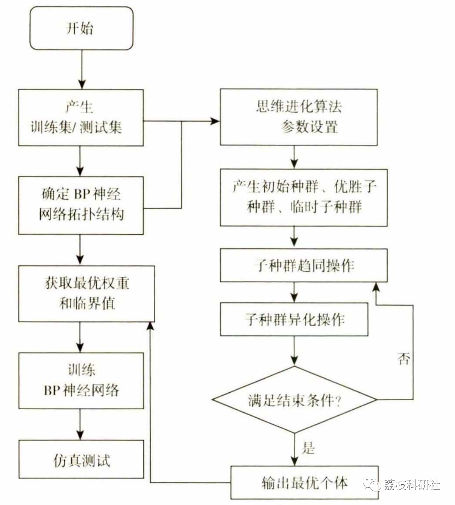
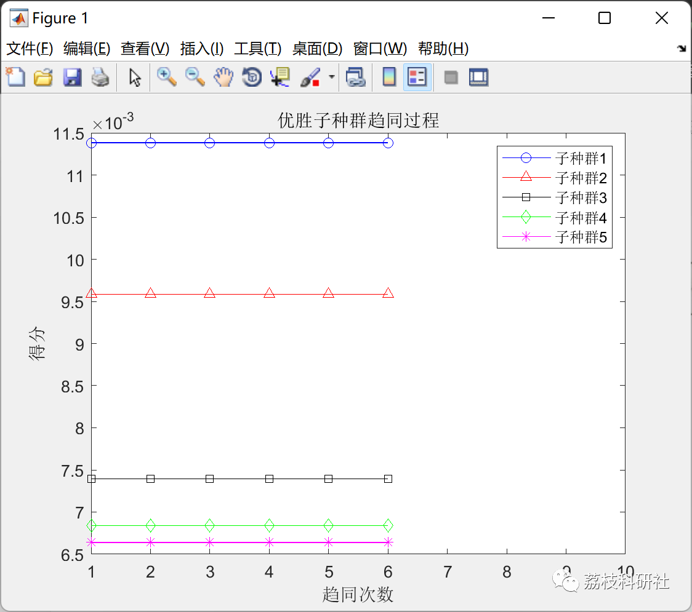
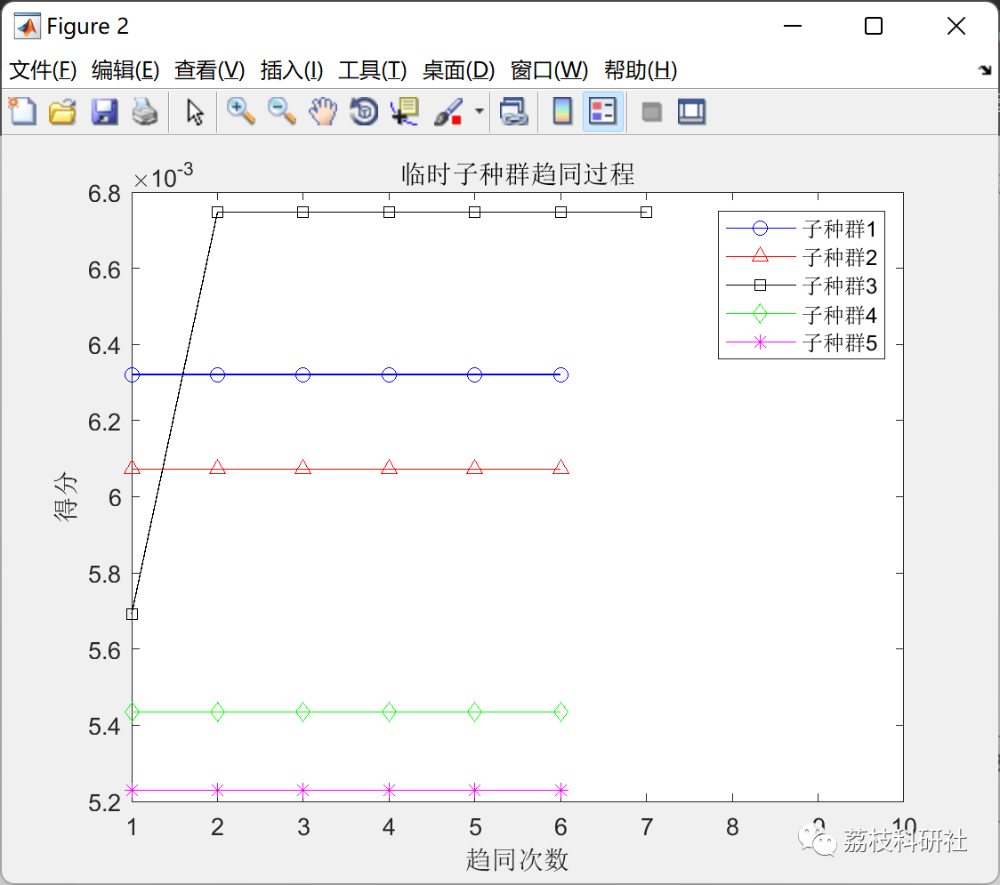
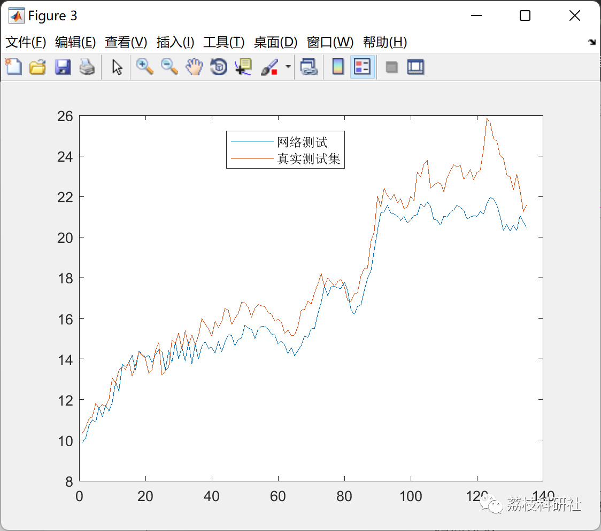

# Optimization of BP Neural Network Based on Evolutionary Algorithm (Matlab Code)

💥💥💥💞💞💞 Welcome to this blog❤️❤️❤️💥💥💥
🏆 Bloggers' Advantages: 🌞🌞🌞 The content of the blog strives for rigorous thinking and clear logic to facilitate readers.
⛳️ Mantra: "A journey of a thousand miles is made in the last ninety."
Litchi Research Society
Code Collection: Power Systems, Intelligent Algorithms and Applications, Neural Network Prediction, Path Planning, Optimized Scheduling, Workshop Scheduling, Image Processing, Signal Processing, ...
🎁 Special Section Links:
🌈🌈🌈🌟🌟🌟 Electrical Code Intelligent Algorithms and Their Applications Path Planning Neural Network Prediction Optimized Scheduling Image Processing Workshop Scheduling Signal Processing Romantic Her Thoughts My Philosophy Math Modeling Complete Code Issues
Sources of literature and code reproduction:
💥1 Overview
1.1 Overview of Evolutionary Algorithms
Evolutionary algorithms (EC) are randomized search algorithms that combine computer science with biological evolution. They evolve through the process of natural selection, evaluating each search position in the state space to find the best position, then searching from this position until the target. Unlike ordinary algorithms, they possess the ability to search in a group. Therefore, evolutionary algorithms have been widely applied in fields such as artificial intelligence, image processing, combinatorial problems, finding optimal solutions, and machine learning. However, while focusing on their advantages, it is also important not to overlook some of their shortcomings and limitations. For example, in engineering applications, the premature convergence and slow convergence speed exhibited by evolutionary algorithms need continuous improvement to become more perfect.
1.2 Optimizing BP Neural Networks with Evolutionary Algorithms
The self-learning capability of the BP neural network is weak, and its search performance is poor, which easily leads to inaccurate results. Therefore, this paper starts from the initial weights and critical values of the BP neural network, and improves it based on the feature of the thought evolution algorithm that has strong search capabilities. Firstly, according to the topological structure of the BP neural network, random encoding is performed for the weights and critical values of each layer; then, using the thought evolution algorithm, the original solution is found according to the selected scoring function through iteration, and an ideal optimal solution is sought; finally, the optimal solution is introduced into the initial weights and critical values of the BP neural network to simulate learning.
1.3 The steps of optimizing the Backpropagation Neural Network with Evolutionary Computation Algorithm
The optimized design process flowchart is shown in the figure below.
📚2 Running Results
🎉3 References
[1] Wang Yongliang. Optimizing BP Neural Networks with Evolutionary Algorithms for Nonlinear Function Fitting Applications [J]. Xinzhou Normal University Journal, 2021, 37(5): 35-41
[2] Liu Jun. Application Research of Evolutionary Algorithms in Fitting Nonlinear Functions with Backpropagation Neural Networks [J]. Mianyang Normal University Journal, 2015, 0(2): 79-83
🌈4 Matlab code implementation
Click the "Read Full Content" button at the bottom left of the article.

## Images

<!-- PAYMENT_BLOCK -->

## Get this dataset

- Payment link (Stripe): [Buy now](https://buy.stripe.com/3cs8yP7sY87d0vu9AB)
- Payment QR code: 

<!-- /PAYMENT_BLOCK -->
